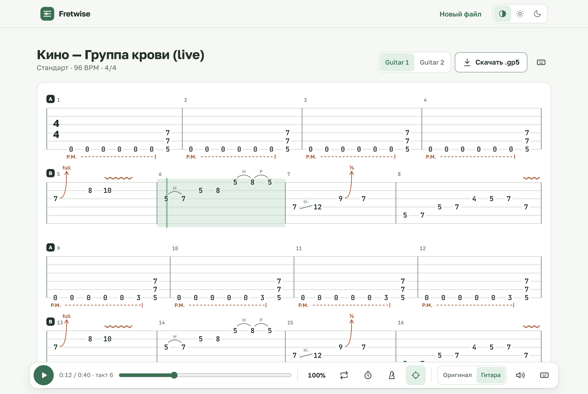

# Fretwise

Fretwise is a local web app that turns audio or video into guitar tablature. It isolates the guitar part, detects notes and arranges them into tabs **a human can actually play**, so you never get impossible stretches like `1-3-15-17-18` in one chord.



The resulting tab plays back in the browser with a cursor synced to the audio, and you can export it to `.gp5` for Guitar Pro. Everything runs locally: your files and the models stay on your machine.

## Features

- Upload any audio **or video** file (MP3, WAV, FLAC, M4A, MP4, MOV, MKV)
- Guitar stem separation with **Demucs** (`htdemucs_6s`)
- Note transcription (pitch, onset, duration) with Spotify's **Basic Pitch**
- **Playability-aware fingering**: a custom Viterbi-style dynamic program over the fretboard. It discards voicings outside the hand span or with two notes on one string, and minimises position shifts
- **Bends and vibrato** read from Basic Pitch's pitch contours, including whole-step bends the tracker splits into two notes
- **Bar lines that follow the music**: beat tracking, 3/4 vs 4/4 detection and downbeat alignment, with pickup bars when needed
- Tunable settings: guitar tuning (Standard, Drop D, Eb, Open D), capo, max fret span, position-shift weight
- Real-time processing progress over **Server-Sent Events**
- Tab viewer with playback of the isolated stem or the original mix and a synced cursor
- **Export to Guitar Pro** (`.gp5`) via PyGuitarPro
- One-command **Docker Compose** setup

## How it works

1. **Ingest**: `ffmpeg` extracts the audio track from any container, including video, and keeps it in stereo because Demucs separates stereo noticeably better.
2. **Separation**: [Demucs](https://github.com/facebookresearch/demucs) (`htdemucs_6s`) isolates the guitar from the mix.
3. **Transcription**: [Basic Pitch](https://github.com/spotify/basic-pitch) detects note pitch, onset and duration on the isolated stem. `expression.py` reads each note's pitch contour to mark bends and vibrato.
4. **Fingering**: `tab_builder.py` assigns notes to strings and frets. It never emits a chord whose fretted notes exceed the hand span or share a string, and it keeps the fretting hand in one position as long as possible.
5. **Rhythm**: `rhythm.py` tracks beats with librosa, chooses between 3/4 and 4/4 and finds the first downbeat, so bars line up with the music.
6. **Export**: [PyGuitarPro](https://github.com/Perlence/PyGuitarPro) writes the result to `.gp5` with the real tuning, the capo in the track's capo field, and bends and vibrato as Guitar Pro effects.
7. **UI**: a React app streams progress, plays the isolated or original track and renders the tab with a playback cursor.

## Tech stack

| Layer | Technologies |
|---|---|
| Backend | Python 3.11, FastAPI, Uvicorn, Pydantic, sse-starlette |
| ML / audio | PyTorch, Demucs, Basic Pitch (ONNX), librosa, ffmpeg |
| Export | PyGuitarPro |
| Frontend | React 19, TypeScript, Vite, Tailwind CSS |
| Infra | Docker, Docker Compose, nginx |
| Tests | pytest, httpx |

## Getting started

### Option 1: Docker (recommended)

```bash
docker compose up --build
```

Open <http://localhost:5173>. nginx serves the built frontend and proxies `/api/*` to the backend.

The first build takes a while because the backend image pulls PyTorch and the ML stack. The first processed track also downloads the Demucs weights. Named volumes keep state between restarts:

- `jobs_data`: uploaded files, intermediate stems and job results
- `model_cache`: Demucs weights (several hundred MB), referenced via `TORCH_HOME=/cache/torch`

The backend container runs as an unprivileged user, reports its health on `/api/health`, and the frontend only starts once that check passes.

Reset everything, including cached models and jobs:

```bash
docker compose down -v
```

### Option 2: Local development

Requirements: **Python 3.11** (the pinned NumPy/PyTorch versions don't support 3.13 yet), **Node.js 22+**. You don't need to install `ffmpeg` separately because the backend uses bundled binaries from `imageio-ffmpeg` / `static-ffmpeg`.

```bash
# Backend: FastAPI on http://127.0.0.1:8000
cd backend
python -m venv .venv
source .venv/bin/activate        # Windows: .venv\Scripts\activate
pip install -r requirements.txt
uvicorn app.main:app --reload --port 8000
```

```bash
# Frontend: Vite on http://localhost:5173 (proxies /api to the backend)
cd frontend
npm install
npm run dev
```

### Configuration

| Variable | Default | Meaning |
|---|---|---|
| `FRETWISE_MAX_CONCURRENT_JOBS` | `1` | How many tracks are processed at once. Extra uploads wait in a queue and see their position. Each Demucs run can use several GB of RAM. |
| `FRETWISE_JOB_TTL_HOURS` | `24` | Finished jobs and their files are deleted after this many hours. Job folders left over from a previous run are removed on startup. |

A finished job can also be deleted right away with `DELETE /api/jobs/{id}`.

### Models

Models are downloaded on first use and cached:

- **Demucs `htdemucs_6s`**: several hundred MB, cached in `~/.cache/torch/hub/checkpoints/`. Downloading it makes the first track the slowest one.
- **Basic Pitch**: ships with the `basic-pitch` package, so there is nothing to download.

## Tests

```bash
cd backend
python -m pytest

cd frontend
npm test        # Vitest + Testing Library
npm run lint
```

The backend suite needs neither PyTorch nor Demucs nor network access, because separation is imported lazily and stubbed in tests. CI (`.github/workflows/ci.yml`) installs the requirements without `torch`/`torchaudio`/`demucs` and runs pytest, then runs the frontend's lint, tests and build.

The unit tests cover the fretboard model, the tab builder (span and string constraints, position minimisation), Guitar Pro export and the HTTP API. Demucs is replaced with a pass-through stub in tests because it is too heavy for unit tests. The full pipeline can be checked end to end with the scripts in `backend/scripts/`.

## Project structure

```
.
├── backend/
│   ├── app/
│   │   ├── api/          # REST + SSE endpoints: upload, jobs, tabs/export
│   │   ├── jobs/         # Background job manager
│   │   ├── models/       # Pydantic schemas
│   │   ├── pipeline/     # ingest → separation → transcription → tab_builder → gp_export
│   │   └── main.py       # FastAPI app
│   ├── scripts/          # Smoke / end-to-end helpers
│   ├── tests/            # pytest suite + synthetic audio fixture
│   └── Dockerfile
├── frontend/
│   ├── src/
│   │   ├── api/          # Typed API client
│   │   ├── components/   # UploadDropzone, SettingsPanel, ProcessingTimeline, AudioPlayer, TabViewer
│   │   └── App.tsx
│   ├── nginx.conf        # Production proxy config
│   └── Dockerfile
└── docker-compose.yml
```

## License

[MIT](LICENSE)
